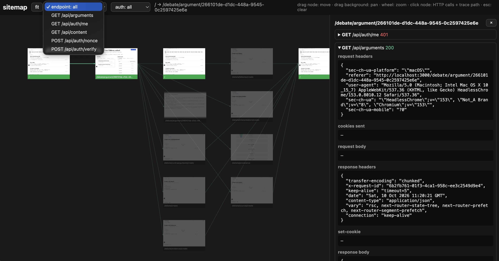

# journey

Map any web app as an interactive sitemap. A Playwright crawler traverses your app like a user, then renders every page, transition, and API call in a zoomable viewer — packaged as an opencode `/sitemap` command.



[Live demo](https://mfloriach.github.io/journey/)

## Install

```sh
npm i -D https://github.com/mfloriach/journey
```

Installs the command into `.opencode/` and scaffolds an empty `sitemap/` output directory.

## Features

- Full traversal of the app as a user would navigate it.
- Per-page HTTP inspector: requests, responses, headers, and bodies.
- Auth visibility: distinguishes public pages from wallet-gated ones.
- Filtering by API endpoint and auth state.

## How it works

1. **Install** — the package scaffolds the `/sitemap` command, the crawler script, and the viewer template into your project.
2. **Crawl** — run `/sitemap` (or `BASE_URL=… npx tsx .opencode/scripts/shoot.ts`). Playwright BFS-walks every route, clicks buttons and tabs, screenshots each state, and records same-origin API traffic plus wallet gating.
3. **View** — the crawl emits `sitemap/` (`sitemap.json`, `sitemap-data.js`, `shots/`). Open `sitemap.html` directly (`file://` works) to pan, zoom, trace paths, and inspect calls.
